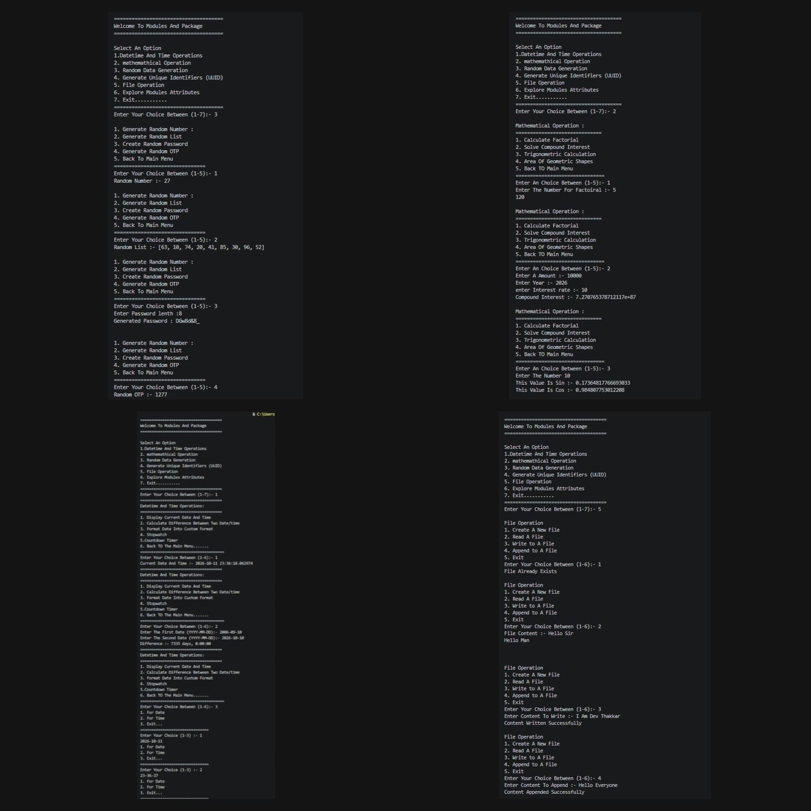

# Modules & Package 

## Subtitle
A Practical Python Project For Exploring Built-In  Modules Through An Interctive Terminal Interface
---

# Features
- Date and time operations
- Factorial and compound interest calculations
- Trigonometric calculations and geometric areas
- Random number and list generation
- Random password and OTP generation
- UUID generation
- File creation, reading, writing, and appending
- Exploring Python module attributes

---

# Technologies Used

- **Programming Language:** Python

- **Editor:** VS Code 

---

# Concepts Used

The following Python concepts are used in this project:

- Modules and imports
- Menu-driven programming
- Conditional statements and loops
- User input and type conversion
- Mathematical calculations
- File handling
---

# How To Use

1. Run the program.
2. Select an option from the main menu.
3. Enter the requested values.
4. View the output in the terminal.
5. Return to the main menu or exit
---

# Installation

### Step 1: Install Python

Download and install Python from:

```
https://www.python.org/
```

### Step 2: Clone or Download Project

Download the project files into your system.

### Step 3: Run Program

Open terminal:

```
python main.py
```

---

# Example Output

```
=====================================
Welcome To Modules And Package 
=====================================

Select An Option
1.Datetime And Time Operations
2. mathemathical Operation  
3. Random Data Generation  
4. Generate Unique Identifiers (UUID) 
5. File Operation  
6. Explore Modules Attributes  
7. Exit........... 
=====================================
Enter Your Choice Between (1-7):- 1
=====================================

Datetime And Time Operations:
=====================================
1. Display Current Date And Time 
2. Calculate Difference Between Two Date/time 
3. Format Date Into Custom Format 
4. Stopwatch 
5.Countdown Timer
6. Back TO The Main Menu.......
======================================
Enter Your Choice Between (1-6):- 1
Current Date And Time :- 2026-10-12 00:38:23.254198
=====================================
Datetime And Time Operations:
=====================================
1. Display Current Date And Time 
2. Calculate Difference Between Two Date/time 
3. Format Date Into Custom Format 
4. Stopwatch 
5.Countdown Timer
6. Back TO The Main Menu.......

```


### Output 



---

# Project Structure

```

│
├── package
   |__ __init__.py
   |__ explore.py
   |__ file.py
   |__ modul.py
│
├── README.md
│
└── data.txt
|
|__ main.py
|
|__ output.png    
```

---

# Author

**Dev Thakkar**
